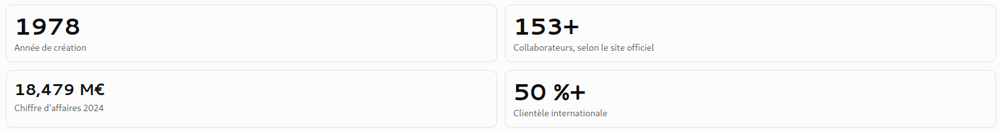
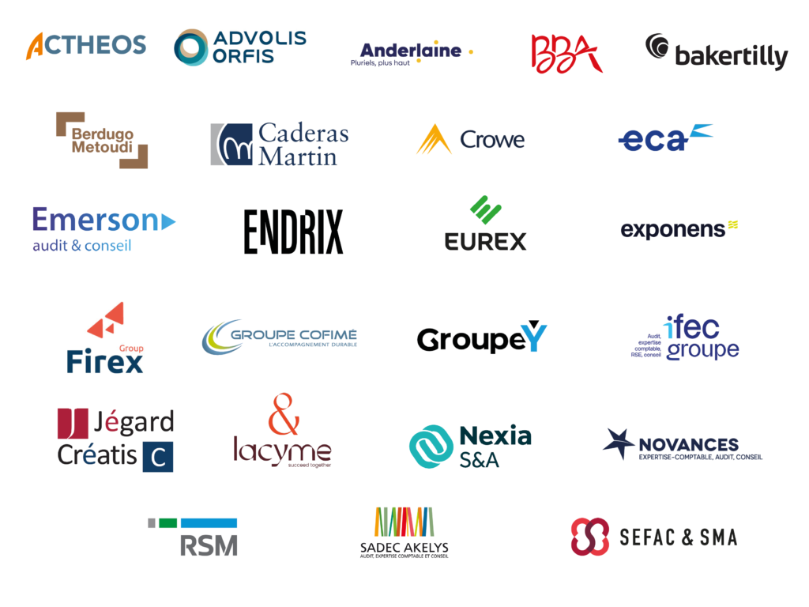

# 🐉 Préparation à l’entretien RH — Directeur des systèmes d’information chez Caderas Martin

L’objectif de ton entretien RH sera de démontrer trois choses : ta compréhension des enjeux de l’entreprise, ta capacité à faire du système d’information un levier de performance et ta motivation à rejoindre Caderas Martin, au-delà de la seule dimension technologique.

Pour un poste de DSI, il faut articuler ton discours autour de la stratégie de l'entreprise, de ses métiers, de la transformation numérique, de la sécurité, de la qualité de service et de l'accompagnement des équipes.

## 1. Synthèse des informations clés sur Caderas Martin

🦜 Cabinet d’expertise comptable, d’audit et de conseil : Fondé en **1978**, le cabinet accompagne des entreprises françaises et internationales dans leurs problématiques comptables, financières, fiscales et sociales. Il privilégie une relation client personnalisée et une organisation transversale.

📃 Site officiel : [caderas-martin.com](https://www.caderas-martin.com/?utm_source=chatgpt.com) 

🕐 Rapport de transparence 2025. Le chiffre d’affaires publié dans ce rapport atteint 19,011 M€ HT au 31 août 2025.

---

### Son positionnement et ses métiers

Le cabinet exerce principalement trois activités complémentaires :

- ✔️ Expertise comptable et conseil : tenue et révision comptables, accompagnement des dirigeants, analyse financière et conseil en gestion.
    
- ✔️ Audit et commissariat aux comptes : fiabilisation de l’information financière et contrôle des comptes.
    
- ✔️ Services spécialisés : paie, ressources humaines, accompagnement fiscal et social, missions de conseil spécifiques.
    

Sa clientèle comprend notamment des PME, des ETI, des filiales de groupes étrangers et des entreprises de secteurs variés.

#### Particularités différenciatrices : Une forte dimension internationale

🏳️‍🌈 Plus de la moitié de la clientèle est internationale. Le cabinet possède notamment un Japan Desk, un Nordik Desk et un bureau de liaison à Tokyo. Cette dimension implique des échanges internationaux, des exigences de confidentialité et des besoins de collaboration numérique.

#### Une organisation transverse

Le cabinet adapte ses équipes aux besoins des missions plutôt que de rattacher systématiquement les collaborateurs à un associé unique. Le SI doit donc faciliter le partage des dossiers, la gestion des habilitations et la circulation de l’information entre équipes.

#### Une culture déjà orientée vers la digitalisation

Utilisation de logiciels spécialisés en comptabilité, audit, consolidation, paie, planification et partage documentaire. Le cabinet propose également des outils collaboratifs et un espace client. Le poste de DSI s'inscrit donc dans un environnement numérique existant, à faire évoluer plutôt qu'à construire de zéro.

---

### Culture d’entreprise et valeurs

Les éléments mis en avant par le cabinet sont :

- La **qualité technique** et la **fiabilité** des prestations.
    
- La **proximité avec les clients** et l’**implication des associés**.
    
- La **bienveillance**, l’**esprit d’équipe** et la **transmission des connaissances**.
    
- L’**amélioration continue** et la recherche de solutions numériques utiles aux métiers.
    

Le cabinet indique explicitement vouloir utiliser des outils performants et limiter les tâches sans valeur ajoutée. C’est un point particulièrement intéressant à exploiter pour expliquer ta vision du rôle d’un DSI.

---

## 2. Les enjeux stratégiques du SI à comprendre avant l’entretien

Il faut distinguer les faits publiés par le cabinet des hypothèses que tu pourras vérifier en entretien. Les enjeux suivants sont des pistes de réflexion pertinentes pour un DSI, pas un diagnostic de l'état actuel de son informatique.

#### 1. Sécurité, confidentialité et continuité d’activité

Le cabinet manipule des données comptables, financières, fiscales, sociales et des informations sensibles concernant ses clients. Les priorités sont donc la cybersécurité, les sauvegardes restaurables, la gestion des identités et des accès, la protection des postes, la réponse aux incidents et la continuité de service.

#### 2. Modernisation et cohérence du portefeuille applicatif

L’enjeu consiste à faire fonctionner ensemble les outils métiers, la GED, la paie, les applications collaboratives, le reporting et les solutions de dématérialisation. Il faut rechercher la simplicité d’usage, la qualité des interfaces, la maîtrise des coûts et la réduction des doubles saisies.

#### 3. Facturation électronique et transformation des processus

C’est un sujet particulièrement concret : le cabinet communique sur la réforme et sur le choix d’une plateforme de dématérialisation partenaire. Au 19 octobre 2026, la réception des factures électroniques est obligatoire depuis le 1er septembre 2026 pour les entreprises concernées ; l’émission suit un calendrier progressif selon la taille de l’entreprise. Il faut donc vérifier où en est le cabinet dans son propre déploiement et dans l’accompagnement de ses clients.

#### 4. Expérience utilisateur et adoption

Dans un cabinet de cette taille, l'informatique doit être un facilitateur du quotidien : disponibilité des applications, assistance réactive, accès sécurisé aux dossiers, mobilité et accompagnement des utilisateurs. Une évolution technologique n’a de valeur que si elle améliore effectivement le travail des collaborateurs.

---

#### 5. Pilotage, maîtrise des coûts et innovation

Le DSI doit arbitrer entre maintien en conditions opérationnelles, investissements, projets métiers et innovations telles que l’automatisation ou l’IA. La réussite se mesure par des résultats tangibles : moins de tâches manuelles, des délais réduits, une meilleure qualité de données et des risques mieux maîtrisés.

Un élément supplémentaire mérite ton attention : le site carrière affiche actuellement un poste de **Directeur de la Transformation Digitale & Data**. Il serait utile de vérifier si le poste de DSI dont tu as été informé correspond à cette fonction, à un poste distinct ou à une évolution de l’organisation.

## 3. Les éléments de motivation à mettre en avant

### Axe 1 — Rejoindre une entreprise où le SI est au cœur du métier

Le cabinet ne vend pas un produit informatique : il vend de l’expertise, du conseil, de la fiabilité et de la confiance. Son SI contribue directement à cette promesse.

Ton argument : tu veux positionner l'informatique comme une fonction stratégique qui améliore le service rendu aux clients et la productivité des collaborateurs.

Formulation possible :

> « Ce qui m'intéresse chez Caderas Martin, c'est que le système d'information est directement lié à la qualité du service rendu aux clients. Dans un cabinet d'expertise comptable et d'audit, la disponibilité des outils, la sécurité des données et la fluidité des processus sont essentielles. Je souhaite inscrire la DSI dans cette logique : un SI fiable et sécurisé, mais également un levier de performance et de différenciation. »

---

### Axe 2 — Participer à une transformation numérique concrète

Le cabinet a déjà engagé une démarche de digitalisation et travaille sur les évolutions de ses outils comptables et de facturation électronique.

Ton argument : tu es attiré par un contexte où il faut articuler les besoins métiers, les choix technologiques, la conduite du changement et les résultats opérationnels.

> « Je suis particulièrement motivé par la possibilité de faire évoluer un système d'information déjà structuré, en priorisant les projets qui apportent une valeur mesurable aux métiers. La transformation numérique doit se traduire par des processus plus simples, une meilleure circulation de l'information et davantage de temps consacré aux activités à valeur ajoutée. »

### Axe 3 — Travailler dans une structure à taille humaine et à dimension internationale

Caderas Martin associe une taille intermédiaire, une **organisation transversale** et une clientèle largement internationale. Son site met également en avant la **proximité managériale et l'esprit collectif.**

Ton argument : tu peux valoriser l'intérêt d'une fonction qui travaille directement avec les associés, les équipes métiers et les partenaires technologiques, avec des décisions proches du terrain.

> « J'apprécie les environnements dans lesquels la DSI peut travailler en proximité avec les décideurs et les utilisateurs. La taille du cabinet, sa diversité de métiers et son ouverture internationale me semblent offrir un contexte intéressant pour concilier vision stratégique, pragmatisme opérationnel et accompagnement humain. »

---

### Axe 4 — Construire une informatique durable, sécurisée et utile

La confidentialité des données, la conformité et la continuité des activités sont essentielles dans ce secteur.

Ton argument : tu souhaites associer la modernisation du SI à une maîtrise rigoureuse des risques, plutôt que de privilégier l'innovation pour elle-même.

> « Pour moi, la performance d'une DSI repose sur un équilibre entre trois dimensions : la robustesse opérationnelle, la maîtrise des risques et la capacité à accompagner les évolutions du métier. Je souhaite construire une trajectoire qui concilie ces trois dimensions, avec des priorités partagées avec la direction et des résultats mesurables. »

## 4. Comment répondre à la question « Pourquoi Caderas Martin ? »

Ce qui m'attire chez Caderas Martin, c'est d'abord la combinaison entre un cabinet établi, reconnu pour son expertise, et une volonté de faire évoluer ses pratiques et ses outils.

J'ai identifié trois dimensions particulièrement intéressantes : la diversité des métiers de l'expertise comptable, de l'audit et du conseil, la dimension internationale de la clientèle et la place importante du numérique dans la qualité du service rendu.

Dans ce contexte, je vois le rôle du DSI comme un rôle à la fois stratégique et opérationnel. Il s'agit de garantir un système d'information fiable et sécurisé, tout en faisant évoluer les applications et les processus pour améliorer l'efficacité des équipes et l'expérience des clients.

La transformation numérique, la maîtrise des risques et l'accompagnement du changement sont des sujets qui rendent cette fonction particulièrement stimulante.

Enfin, je suis sensible à la dimension humaine d'une structure à taille humaine, où la proximité avec les décideurs et les équipes permet de construire des solutions adaptées aux besoins réels.

C'est cette combinaison entre enjeux technologiques, impact métier et proximité humaine qui motive mon intérêt pour Caderas Martin.

Conseil important : cette réponse gagnera en force si tu y ajoutes un exemple précis de ton parcours : une transformation réussie, une amélioration de la disponibilité du SI, une réduction des coûts, un projet de cybersécurité ou une équipe que tu as accompagnée.

---

## 5. Les questions RH probables et la manière d'y répondre

L'entreprise indique que son entretien RH porte notamment sur le parcours, le projet professionnel, les valeurs et les motivations du candidat.

|Question probable|Ce que le recruteur cherche à évaluer|
|---|---|
|Pourquoi souhaitez-vous nous rejoindre ?|Une motivation spécifique à Caderas Martin, pas seulement au poste de DSI.|
|Pourquoi envisagez-vous de quitter votre poste actuel ?|Une démarche positive et cohérente dans ton évolution.|
|Quel est votre style de management ?|Ta capacité à fédérer, responsabiliser et accompagner les équipes.|
|Comment gérez-vous les priorités contradictoires ?|Ton discernement entre urgence opérationnelle, risque et transformation.|
|Comment gérez-vous un désaccord avec un associé ou un dirigeant ?|Ton aptitude à argumenter, écouter et arbitrer sans rigidité.|
|Quelle est votre principale réalisation professionnelle ?|Des résultats concrets et ta contribution personnelle.|
|Quel est votre principal axe de progrès ?|Du recul sur toi-même et une capacité d'amélioration.|
|Quelles sont vos attentes en matière de rémunération ?|La cohérence entre tes responsabilités, ton expérience et le poste.|

---

### Les trois messages à faire passer sur ton profil

- Un DSI orienté métier : tu comprends que la technologie doit servir la stratégie, les clients et les collaborateurs.
    
- Un dirigeant capable d'arbitrer : tu sais prioriser, maîtriser les risques et rendre les décisions compréhensibles.
    
- Un manager qui embarque les équipes : tu sais expliquer les changements, écouter les utilisateurs et développer les compétences.
    

*Pour les questions sur tes réalisations, prépare trois exemples au format STAR : situation, tâche, actions, résultats. Dans chaque exemple, chiffre le résultat dès que possible et distingue clairement ce que tu as personnellement réalisé de ce qui relève de l'équipe.*

---

## 6. Les questions pertinentes à poser au recruteur

Le but n'est pas de présenter un audit informatique dès le premier entretien, mais de montrer que tu réfléchis déjà aux enjeux de la fonction.

### Sur le poste et ses objectifs

- Quelles sont les raisons qui conduisent le cabinet à recruter aujourd'hui sur cette fonction ?
- Quelles seraient les trois priorités attendues du DSI au cours des six à douze premiers mois ?
- Quel est le périmètre exact du poste : infrastructure, cybersécurité, applications métiers, data et transformation digitale ?

### Sur l'organisation et la gouvernance
- À qui le DSI est-il rattaché et comment les décisions informatiques sont-elles arbitrées avec les associés ?
- Quelle est la composition de l'équipe informatique et quelle part des services est externalisée ?
- Comment les besoins des différents métiers sont-ils recueillis et priorisés ?
### Sur la transformation numérique
- Où en est le cabinet dans l'évolution de ses outils comptables et de sa stratégie de facturation électronique ?
- Quels sont les principaux enjeux actuels en matière de cybersécurité, de continuité d'activité et de gestion des données ?
- Quelle place souhaitez-vous donner à l'automatisation, à la data et à l'intelligence artificielle ?

---

### Sur la réussite dans le poste
- Quels résultats concrets vous permettraient de considérer que le recrutement est une réussite au bout d'un an ?
- Quelle autonomie et quels moyens seront donnés au DSI pour conduire les évolutions prioritaires ?  

Je te recommande d'en retenir quatre ou cinq en fonction du déroulement de l'échange. La question sur les attentes à douze mois est particulièrement utile : elle permet de comprendre si l'entreprise attend principalement un responsable de la production informatique, un directeur de la transformation ou une combinaison des deux.

## 7. Ta vision des 90 premiers jours : un bon sujet pour te différencier

### Jours 1–30

- Comprendre
- Écouter et établir le diagnostic

-> Rencontrer les associés, les responsables métiers, l'équipe informatique et les prestataires. Comprendre les applications, les contrats, les incidents récurrents, les risques de sécurité, les coûts et les projets en cours.

### Jours 31–60

- Prioriser
- Définir une feuille de route partagée

-> Hiérarchiser les risques et les projets selon leur valeur métier, leur urgence, leur coût et leur faisabilité. Identifier quelques améliorations rapides et définir des indicateurs de performance.

### Jours 61–90

- Engager
- Lancer les premières actions

-> Présenter une feuille de route validée avec la direction, sécuriser les sujets les plus critiques, engager une première amélioration opérationnelle et clarifier la gouvernance des projets.

Les indicateurs pourraient inclure la disponibilité des applications critiques, le délai de résolution des incidents, le niveau de couverture des sauvegardes testées, l'avancement des projets prioritaires, la satisfaction des utilisateurs et le coût des services informatiques.

---

## 8. Point de vigilance : clarifier le périmètre réel du poste

Le site officiel décrit une fonction informatique existante, avec une responsable informatique, un collaborateur et un associé impliqué dans les sujets stratégiques. Il mentionne aussi un projet de renouvellement de l'outil comptable et de sélection d'une solution de facturation électronique.

En parallèle, le site carrière affiche une offre de Directeur de la Transformation Digitale & Data.

Il serait donc pertinent de déterminer si le recrutement vise :

- une prise de responsabilité hiérarchique sur l'informatique existante ;
    
- une extension du rôle vers la stratégie, les applications, la data et la transformation ;
    
- ou une réorganisation de la gouvernance informatique et numérique.
    

Cette distinction conditionne les compétences à mettre en avant, les questions à poser et la façon de présenter ta vision du poste.

## 9. La fiche mémo à retenir avant l'entretien

Caderas Martin en quelques mots : cabinet créé en **1978**, plus de **153 collaborateurs**, plus de 50 % de clientèle internationale, expertise comptable, audit et conseil, culture de proximité et organisation transverse.

Ses enjeux SI les plus visibles : continuité de service, sécurité et confidentialité, cohérence des outils métiers, dématérialisation comptable, facturation électronique et accompagnement des utilisateurs.

Ta motivation centrale : faire du SI un levier de qualité, d'efficacité et de confiance, tout en conservant une forte exigence de sécurité et de maîtrise des risques.

Ton positionnement : un dirigeant qui sait écouter les métiers, arbitrer les investissements, conduire le changement et transformer une stratégie en résultats concrets.

___________________________________________

### Personnes en contact

> Matthieu LEJARDS : Associé (11 ans chez Caderas)
> 
> Marie-Hélène VOLPE : Associée (27 ans chez Calderas)
> 
> Sandrine Clémente : (Admin sys) => 35 années de dévouement et d’innovation 

### Association ATH

ATH : **Association Technique d’Harmonisation** est une émanation de **32 cabinets** indépendants d’audit

Une vision équilibrée du management :

    Exiger sans pression excessive,
    Déléguer sans abandonner,
    Encadrer sans brider l’autonomie,
    Former sans imposer un modèle unique.

---

### Le poste

Votre rôle sera à la fois **stratégique**, **opérationnel** et **transverse**.

Vous aurez notamment pour responsabilités de :

   - définir et mettre en œuvre la stratégie de transformation numérique du cabinet et son schéma directeur
    - accompagner la transformation des métiers de l’expertise comptable, de l’audit et du social
    - piloter le portefeuille de produits numériques du cabinet et définir leur feuille de route
    - faire évoluer notre portail clients, nos outils internes et nos services numériques
    - superviser les projets de développement d’applications internes et externes 
    - identifier et développer les cas d’usage liés à l’intelligence artificielle et à l’automatisation
    - garantir l'interopérabilité de nos logiciels et la qualité de nos données ;
    - définir et piloter la politique de gouvernance et de valorisation des données
    - piloter les partenaires technologiques, éditeurs, développeurs et prestataires ;
    - superviser les enjeux de cybersécurité, en lien avec nos partenaires spécialisés ;
    - veiller à la prise en compte des exigences liées au RGPD et à la protection des données dans les projets numériques ;
    - accompagner les équipes dans l’évolution de leurs pratiques et favoriser l’adoption des nouveaux outils.

---

Vous travaillerez en étroite collaboration avec l’ensemble des directions métiers et coordonnerez les différents acteurs internes et externes intervenant sur les projets numériques.

Nous recherchons avant tout un(e) bâtisseur(se), capable de transformer une vision en projets concrets et mesurables.

Issu(e) d’une formation supérieure de type école d’ingénieur, Master, école de commerce avec une spécialisation numérique ou équivalent, vous justifiez d’une expérience confirmée d’au moins 10 ans dans des fonctions de direction de la transformation, direction produit, direction des systèmes d’information ou direction de l’innovation.

Vous avez déjà piloté des projets de transformation numérique d’envergure et êtes capable de conjuguer vision stratégique, compréhension technique et conduite du changement.

Vous maîtrisez ou disposez d’une solide culture autour des sujets suivants :

    transformation numérique et systèmes d’information ;
    produits et services numériques ;
    intelligence artificielle et automatisation ;
    data et gouvernance des données ;
    développement applicatif ;
    cybersécurité ;
    pilotage de projets complexes et de partenaires.

---

Une expérience acquise dans une entreprise de services, un éditeur de logiciels, une ESN ou une entreprise fortement digitalisée sera particulièrement appréciée.

Au-delà de votre expertise, nous recherchons une personnalité capable de fédérer, convaincre et accompagner les équipes, avec une forte capacité à travailler en transversal.

Autonomie pour définir la feuille de route numérique du cabinet
Prioriser les projets et construire progressivement une véritable direction de la transformation.

Vous aurez l’opportunité d’avoir un impact direct et mesurable sur :
- la productivité et le quotidien de nos équipe    
- l’automatisation et la simplification de nos processus    
- l’expérience de nos clients     
- la qualité et la valorisation de nos données  
- le développement de nouveaux produits et services numériques 
- et, plus largement, l’évolution du modèle du cabinet.
    
Un poste au cœur de notre stratégie pour faire du numérique, de la donnée et de l’IA des leviers durables de différenciation et de création de valeur.

---

Les questions à préparer :
Pour cet entretien, je m'attendrais notamment à :

1. **« Quelle serait votre priorité durant vos 100 premiers jours ? »**
    
2. **« Comment construisez-vous une stratégie SI lorsque vous arrivez dans une organisation que vous ne connaissez pas ? »**
    
3. **« Comment arbitrez-vous entre maintien en condition opérationnelle, dette technique et nouveaux projets ? »**
    

4. **« Quelle est votre approche de la cybersécurité ? »**
    
5. **« Que feriez-vous avec l'IA ? »**
    
6. **« Comment faites-vous travailler la DSI avec les métiers ? »**
    

7. **« Comment managez-vous une équipe de 15 à 20 personnes ? »**
    
8. **« Comment gérez-vous les prestataires et l'externalisation ? »**
    
9. **« Comment mesurez-vous la performance d'une DSI ? »**
    
10. **« Quelle relation souhaitez-vous avoir avec le DG et les membres du CODIR ? »**

Ce qui me donne envie de rejoindre => c’est d’abord la combinaison entre une **mission qui a du sens**  et un véritable **enjeu de transformation**.

Je trouve particulièrement intéressant que le système d’information soit aussi directement **connecté au cœur de métier de ...** : la gestion des droits, la relation avec les clients, la donnée et les nouveaux enjeux liés notamment à l’intelligence artificielle. Cela donne au DSI une responsabilité qui va bien au-delà du fonctionnement de l’IT.

---

Le deuxième élément qui m’attire beaucoup, c’est la dimension stratégique du poste. Le rattachement à la Direction Générale et la participation au comité de direction montrent que la DSI doit être un partenaire des métiers et contribuer aux choix structurants de l’organisation. C’est exactement la dimension que je recherche aujourd’hui : être capable à la fois de garantir un SI robuste et sécurisé et d’utiliser le numérique comme un levier de transformation et de création de valeur.

Enfin, la **taille de la structure et de l’équipe** ainsi que l’étendue du périmètre me plaisent beaucoup. Il y a à la fois un enjeu de **stratégie**, de **transformation technologique**, de **cybersécurité**, de **data** et d’**IA**, mais aussi un véritable **enjeu humain et managérial**.

C’est donc un poste qui me paraît particulièrement complet, avec une vraie capacité d’impact. Et c’est précisément ce que je recherche : rejoindre une organisation dont la mission m’intéresse, comprendre ses enjeux, construire une trajectoire SI pragmatique et embarquer les équipes et les métiers dans cette transformation.

---
## 1. « Quelle serait votre priorité durant vos 100 premiers jours ? »

> « Ma priorité ne serait pas d'arriver avec un plan de transformation déjà écrit. Les 100 premiers jours seraient d'abord consacrés à comprendre, écouter et établir un diagnostic partagé.
> 
> Je travaillerais sur **quatre dimensions** : les enjeux stratégiques, la perception de la DSI par les métiers, la robustesse du SI et les risques — notamment cyber, opérationnels et liés aux dépendances technologiques.
> 
> Je rencontrerais individuellement les membres du CODIR et les principaux responsables métiers, mais aussi l'équipe DSI. Je chercherais à comprendre ce qui fonctionne bien, ce qui fait perdre du temps, les irritants majeurs et surtout les sujets sur lesquels l'entreprise prend aujourd'hui un risque.
> 
> À l'issue de cette phase, je voudrais être capable de présenter trois choses au DG et au CODIR : une photographie objective de la situation, les quelques priorités réellement structurantes et une trajectoire à 2 ou 3 ans, avec des premières actions visibles à court terme.
> 
> Mon objectif au bout de 100 jours serait donc moins d'avoir lancé beaucoup de projets que d'avoir créé de la clarté, de la confiance et un alignement sur les priorités. »

---

### Message implicite

**« Je ne suis ni un pompier, ni un DSI qui arrive avec des certitudes. Je prends le temps de comprendre avant d'engager l'organisation. »**

# 2. « Comment construisez-vous une stratégie SI lorsque vous arrivez dans une organisation que vous ne connaissez pas ? »

> « Je pars toujours de la **stratégie de l'entreprise**, et non de la technologie.
> 
> Je cherche d'abord à comprendre où l'organisation veut être dans trois à cinq ans, quels sont ses enjeux de développement, ses contraintes réglementaires, ses risques et ses transformations métiers.
> 
> Ensuite, je fais le lien avec le SI : quelles capacités technologiques sont nécessaires pour accompagner cette ambition ? Où sont les écarts entre la situation actuelle et la cible ?
> 
> Je regarde alors le portefeuille applicatif, l'architecture, la data, les infrastructures, la cybersécurité, les compétences internes et les dépendances externes.
> 
> À partir de là, je construis une trajectoire qui distingue clairement ce qui est indispensable, ce qui crée de la valeur et ce qui peut attendre.
> 
> Une bonne stratégie SI, pour moi, n'est donc pas un catalogue de projets technologiques. C'est un choix assumé de priorités, d'investissements et de risques, aligné sur la stratégie de l'entreprise. »

### Phrase forte

> **« La stratégie SI doit être la traduction technologique de la stratégie de l'entreprise, pas l'inverse. »**

---
# 3. « Comment arbitrez-vous entre maintien en condition opérationnelle, dette technique et nouveaux projets ? »

> « Je ne considère pas ces trois dimensions comme concurrentes par principe. Le premier rôle de la DSI est de garantir la continuité et la sécurité du SI ; le deuxième est de réduire progressivement les risques et la dette ; le troisième est d'accompagner la transformation.
> 
> Je raisonne donc en portefeuille et en capacité d'investissement.
> 
> Je commence par sécuriser ce qui est critique : disponibilité, cybersécurité, obsolescence présentant un risque important, dépendances à des fournisseurs ou à des personnes clés.
> 
> Ensuite, je mets en évidence le coût de la dette technique : coût financier, risques opérationnels, frein à l'évolution et complexité.
> 
> Enfin, je priorise les nouveaux projets selon leur valeur métier, leur urgence stratégique et leur niveau de risque.
> 
> Et surtout, je rends les arbitrages explicites au CODIR. Je préfère dire : "voici ce que nous pouvons faire, voici ce que nous ne pouvons pas faire et voici le risque associé", plutôt que de laisser la DSI accumuler des engagements qu'elle ne pourra pas tenir. »

> **« Mon rôle de DSI est aussi de dire non, mais surtout d'expliquer pourquoi et de proposer une alternative. »**

---
# 4. « Quelle est votre approche de la cybersécurité ? »

> « Je considère la cybersécurité d'abord comme un sujet de risque d'entreprise, et pas uniquement comme un sujet technique.
> 
> Ma première question serait donc : quels sont les actifs critiques ? quelles seraient les conséquences d'une compromission ou d'une indisponibilité, et quels sont les scénarios de risque les plus importants ?
> 
> Je travaillerais ensuite sur les fondamentaux : identité et habilitations, protection des données, sauvegardes et capacité de restauration, gestion des vulnérabilités, supervision, sécurité des prestataires, sensibilisation des collaborateurs et surtout capacité de réaction et de continuité d'activité.
> 
> Je veux également que la cybersécurité soit intégrée aux projets dès leur conception, notamment sur les sujets data et IA.
> 
> Enfin, je considère qu'une bonne politique cyber doit être pilotée avec le CODIR. Le comité de direction doit connaître les risques majeurs, le niveau de protection et les décisions qui nécessitent un arbitrage.
> 
> Mon objectif n'est pas d'avoir un SI "zéro risque" — cela n'existe pas — mais d'avoir un niveau de risque connu, maîtrisé et accepté au bon niveau de gouvernance. »

### Phrase à retenir

> **« La cybersécurité est une décision de risque d'entreprise avant d'être une décision technologique. »**

---
# 5. « Que feriez-vous avec l'IA ? »

> « Je commencerais par ne pas considérer l'IA comme une fin en soi.
> 
> Je chercherais d'abord les cas d'usage qui peuvent réellement améliorer l'expérience des collaborateurs et des clients, l'efficacité des collaborateurs ou la qualité des processus.
> 
> Je regarderais notamment trois catégories : l'amélioration de la relation avec les collaborateurs ou les clients, l'optimisation des processus internes et l'exploitation de la donnée pour améliorer la connaissance et la qualité de service.
> 
> Mais compte tenu des missions : une quatrième dimension essentielle : l'IA doit également être regardée sous l'angle de la protection des données clients et de la gouvernance des données.
> 
> Je mettrais donc en place une approche très pragmatique : quelques cas d'usage à forte valeur, un cadre de gouvernance, des règles sur les données et la confidentialité, puis une mesure objective des bénéfices.
> 
> Je préfère avoir trois cas d'usage IA qui créent réellement de la valeur et qui sont maîtrisés plutôt que quinze expérimentations qui ne passent jamais à l'échelle. »

### Et si le DG insiste :

**« Quel premier cas d'usage ? »**

> « Je ne choisirais pas le premier cas d'usage avant d'avoir rencontré les métiers et analysé les données disponibles. Mais je chercherais prioritairement un cas où l'IA peut réduire une charge opérationnelle importante ou améliorer sensiblement le service rendu aux clients, tout en ayant un niveau de risque maîtrisable. »

---
# 6. « Comment faites-vous travailler la DSI avec les métiers ? »

> « Pour moi, la relation DSI-métiers ne doit pas être une relation de client à fournisseur interne. La DSI doit être un partenaire de transformation.
> 
> Cela commence par une gouvernance claire : qui décide, qui priorise et selon quels critères.
> 
> Je veux que les métiers expriment d'abord leurs **besoins** et leurs **enjeux**, plutôt que de demander directement des solutions technologiques. La DSI apporte ensuite son expertise pour construire la réponse.
> 
> Je mets également en place une **gouvernance portefeuille des projets** permettant au CODIR de visualiser les projets, les coûts, les capacités disponibles, les dépendances et les arbitrages.
> 
> Enfin, je suis très attentif à la qualité de la relation au quotidien et au sens du service. Une DSI peut avoir une excellente architecture et être perçue comme mauvaise si elle est difficile à solliciter, trop lente ou trop éloignée des métiers.
> 
> Mon objectif est donc de faire évoluer la perception de la DSI : passer de "ceux qui gèrent l'informatique" à "ceux qui nous aident à transformer l'entreprise". »

> **« Je veux que les métiers viennent voir la DSI avant d'avoir défini la solution, pas après. »**

---
# 7. « Comment managez-vous une équipe de 15 à 20 personnes ? »

> « À cette taille d'équipe, mon rôle n'est pas d'être le meilleur expert technique. Mon rôle est de créer les conditions permettant à l'équipe de réussir.
> 
> Je commence par clarifier l'organisation, les responsabilités et les objectifs. Je veux que chacun sache ce dont il est responsable, mais aussi pourquoi son activité contribue aux objectifs de l'entreprise.
> 
> Je suis très attentif à la qualité du management de proximité, au développement des compétences et à la capacité des managers ou responsables de domaine à prendre des décisions.
> 
> Je cherche également à identifier les dépendances excessives à certaines personnes clés et à construire progressivement de la résilience dans l'organisation.
> 
> Enfin, j'aime donner de l'autonomie tout en maintenant un niveau d'exigence élevé sur les engagements, la qualité de service et la transparence.
> 
> Mon principe est simple : je veux une équipe qui soit capable de fonctionner efficacement sans que tout remonte au DSI. »

> **« Mon ambition n'est pas d'être le centre de décision de la DSI, mais de construire une DSI qui sait décider. »**

---
# 8. « Comment gérez-vous les prestataires et l'externalisation ? »

> « Je ne suis ni pour l'internalisation systématique ni pour l'externalisation systématique. Je cherche à déterminer quelles compétences doivent rester stratégiquement maîtrisées en interne et lesquelles peuvent être confiées à des partenaires.
> 
> Je porte une attention particulière aux sujets où l'organisation pourrait devenir dépendante d'un fournisseur : connaissance du SI, données, architecture, compétences critiques ou capacité à changer de prestataire.
> 
> Je veux également que les contrats soient pilotés par la valeur et la performance, pas uniquement par des engagements de moyens.
> 
> Cela suppose des SLA pertinents, des indicateurs, une gouvernance fournisseur et surtout une capacité interne suffisante pour challenger le prestataire.
> 
> Je considère qu'externaliser une activité ne signifie pas externaliser la responsabilité. Le DSI reste responsable du résultat vis-à-vis de l'entreprise. »

> **« Je peux externaliser l'exécution ; je ne dois jamais externaliser la maîtrise. »**

---
# 9. « Comment mesurez-vous la performance d'une DSI ? »

> « Je mesure une DSI sur quatre dimensions : **fiabilité**, **sécurité**, **valeur** et **capacité de transformation**.
> 
> Sur la fiabilité : disponibilité des services critiques, incidents, qualité de service et respect des engagements.
> 
> Sur la sécurité : niveau de risque, vulnérabilités critiques, incidents, résilience et capacité de restauration.
> 
> Sur la valeur : respect des budgets, bénéfices des projets, satisfaction des métiers et contribution aux objectifs de l'entreprise.
> 
> Et enfin sur la transformation : capacité à délivrer les projets prioritaires, réduction de la dette technique, évolution de l'architecture et capacité à faire évoluer rapidement le SI.
> 
> Je veux surtout éviter de mesurer la performance d'une DSI uniquement à son respect du budget. Une DSI qui respecte son budget mais empêche l'entreprise de se transformer n'est pas une DSI performante.
> 
> Les indicateurs doivent donc être compréhensibles par le CODIR et permettre de prendre des décisions. »

> **« Un KPI de DSI n'a de valeur que s'il permet de prendre une décision. »**

---
# 10. « Quelle relation souhaitez-vous avoir avec le DG et les membres du CODIR ? »

> « Je souhaite avoir avec le DG une relation de confiance, de transparence et de challenge réciproque.
> 
> Mon rôle n'est pas de remonter au DG tous les problèmes de la DSI. Mon rôle est de lui donner une vision claire de la situation, des risques, des options et des décisions qui nécessitent son arbitrage.
> 
> Je veux être capable de lui dire quand tout va bien, mais surtout quand quelque chose ne va pas. Et lorsque je remonte un problème, je veux arriver avec une analyse et plusieurs options, avec leurs conséquences en termes de coût, de délai, de risque et de valeur.
> 
> Avec le CODIR, je souhaite être un partenaire des métiers. Je ne veux pas être le "DSI qui défend son budget" mais celui qui contribue aux arbitrages globaux de l'entreprise.
> 
> Et j'attends également du CODIR qu'il considère le SI comme une responsabilité collective : la transformation numérique ne peut pas être portée par la DSI seule.
> 
> Pour moi, la bonne relation avec le DG repose finalement sur trois choses : pas de surprise, des arbitrages explicites et une confiance fondée sur la transparence. »

> **« Je ne veux pas que le DG découvre un problème informatique ; je veux qu'il découvre avec moi un risque d'entreprise que nous avons choisi de traiter. »**

---
# Les 5 messages clé

1. **Je pars du business, pas de la technologie.**
    
2. **Je sais arbitrer entre risque, coût, valeur et capacité.**
    
3. **Je considère la cybersécurité et la data comme des sujets de gouvernance d'entreprise.**
    
4. **Je construis une DSI autonome, responsabilisée et proche des métiers.**
    
5. **Je suis un partenaire du DG et du CODIR, pas simplement le responsable de l'informatique.**
    
___________________________________________

Le contexte appelle selon moi un **management responsabilisant, fédérateur et assez structurant**, avec une forte capacité d’arbitrage.

Environnement où **l'écoute et la pédagogie** sont importantes, mais où la **clarté des responsabilités et des décisions** l'est tout autant.

## Le modèle que je privilégierais : « cadre clair + autonomie + exigence »

Pour une DSI de 15–20 personnes, je défendrais un management autour de **4 piliers**.

### 1. Donner du sens

Le premier rôle du DSI serait de donner une direction à l'équipe.

> « Nous devons construire un SI fiable, sécurisé et évolutif qui permet de mieux servir les clients, les collaborateurs et d'accompagner sa transformation. »

**Le management doit donc reconnecter régulièrement le travail de la DSI à cette mission.**

### 2. Responsabiliser fortement les managers et référents

Avec 15–20 personnes, je déconseillerais fortement un management où tout remonte au DSI.

Je chercherais plutôt à avoir des responsables clairement identifiés sur quelques grands domaines :

- Run / infrastructure / production
    
- Applications et projets
    
- Data / IA
    
- Cybersécurité
    
- éventuellement architecture / urbanisation selon l'organisation
    

Le DSI fixe le cadre, les objectifs et les priorités.

> **« Je donne de l'autonomie sur le comment, mais je garde la responsabilité du pourquoi, du quoi et des arbitrages. »**

---

### 3. Être très exigeant sur la transparence

Je voudrais instaurer une culture où :

- les problèmes sont remontés tôt ;
    
- les risques sont explicités ;
    
- les engagements sont tenus ;
    
- lorsqu'ils ne peuvent pas l'être, on prévient rapidement ;
    
- les décisions sont documentées ;
    
- les responsabilités sont claires.
    

C'est une culture particulièrement adaptée à une DSI qui doit gérer simultanément **run, cyber, dette technique et transformation**.

---
### 4. Être participatif sur les solutions, directif sur les priorités

> **« Je suis participatif dans la construction des solutions, mais je suis clair et assumé dans les décisions. »**

**Sur un choix d'architecture :**

→ écouter les experts, challenger, faire émerger les options.

**Sur la priorité d'un projet :**

→ écouter les métiers et la DSI, mais finalement arbitrer.

**Sur la cybersécurité :**

→ consulter les équipes, mais ne pas négocier avec le risque critique.

**Sur l'organisation de l'équipe :**

→ construire avec les collaborateurs, mais décider lorsqu'une organisation ne fonctionne pas.

---
# Le management que je présenterais au DG

**« Quel est votre style de management ? »**

Il repose sur **trois principes** : le **sens**, la **responsabilisation** et l'**exigence**.

Je considère que mon rôle de DSI n'est pas de prendre toutes les décisions à la place de l'équipe, mais de créer les conditions pour que **chacun puisse prendre les bonnes décisions dans son périmètre.**

Je donne donc beaucoup d'**autonomie sur le « comment »**, tout en étant très **clair sur les objectifs, les priorités et les résultats attendus.**

Je suis également très attaché à la **transparence**. Je préfère qu'un problème soit remonté tôt, même s'il n'est pas encore résolu, plutôt que de découvrir trop tard qu'un sujet dérive. Pour moi, il doit être possible de dire qu'on rencontre une difficulté, à condition d'arriver avec une analyse et, si possible, des options.

Enfin, je suis participatif dans la construction, mais je sais arbitrer. Je ne recherche pas le consensus à tout prix. Sur les sujets structurants, mon rôle est précisément de prendre la responsabilité de la décision et d'en assumer les conséquences.

Avec une équipe de 15 à 20 personnes, mon ambition serait de construire une DSI responsabilisée, avec des leaders sur leurs domaines, qui fonctionne sans que tout remonte au DSI, tout en restant alignée sur une stratégie et des priorités communes.

---
## Dimension => management du changement

Le  DSI doit  savoir **expliquer, convaincre et créer de l'adhésion**, pas simplement décider.

Posture :

**Écouter → comprendre → expliquer → proposer → arbitrer → embarquer → mesurer.**

# Conclusion

**« Je vais prendre la responsabilité de la DSI pour vous libérer, pas vous donner davantage de problèmes à gérer. »**

### Une formule à placer

> **« Mon objectif à terme serait que le DG puisse avoir confiance dans la DSI sans avoir besoin de la contrôler au quotidien. Il doit savoir que les sujets sont maîtrisés, que les risques sont remontés au bon niveau et que les arbitrages lui sont présentés lorsqu'ils relèvent réellement du CODIR. »**

**Posture à viser pour ce poste** : 
DSI *fédérateur avec ses équipes,
partenaire avec les métiers,
transparent avec le DG et ferme sur les décisions qui relèvent de sa responsabilité.*
